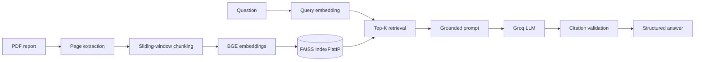

# Financial Report RAG Assistant

A modular Python RAG application for grounding answers about financial PDF reports in retrieved source pages.

## Features

- Page-aware PDF text extraction with image-only and corrupted-PDF handling
- Deterministic 500-word sliding-window chunking with configurable overlap
- Cached BGE-small embeddings, float32 conversion, L2 normalization, and CUDA/CPU selection
- FAISS `IndexFlatIP` exact cosine retrieval with safe JSON and FAISS persistence
- Groq-backed, configurable grounded generation
- Citation validation and the standardized insufficient-information fallback
- Retrieval Recall@1/3/5 and deterministic/semantic answer evaluation
- Typer CLI and FastAPI endpoints

## Architecture



## Installation

```powershell
python -m venv .venv
.\\.venv\\Scripts\\Activate.ps1
python -m pip install -e ".[dev]"
copy .env.example .env
```

Set `GROQ_API_KEY` in `.env` only. Never commit `.env`.

## CLI

```powershell
python -m src.cli ingest --pdf data/reports/example.pdf --index storage
python -m src.cli ask --question "What was the revenue growth in 2024?" --index storage --top-k 5
python -m src.cli evaluate --dataset data/evaluation/questions.json --index storage
```

## API

```powershell
python -m uvicorn src.api:app --reload
```

- `GET /health`
- `POST /documents/ingest` as multipart PDF upload
- `POST /query` with `{"question":"...","top_k":5}`
- `POST /evaluate` with `{"dataset_path":"data/evaluation/questions.json"}`

Example:

```powershell
curl -X POST "http://localhost:8000/query" -H "Content-Type: application/json" -d "{\"question\":\"What was 2023 revenue?\",\"top_k\":5}"
```

## Evaluation

`data/evaluation/questions.json` contains clearly synthetic sample entries. Replace its chunk IDs and reference answers with labels derived from your own report corpus. Retrieval quality is measured from annotated chunk IDs using Recall@1, Recall@3, and Recall@5. Answer checks include unsupported-query refusal, citation presence/validity, optional normalized sentence-embedding similarity, and project-specific numeric/currency annotations that can be added to the dataset.

No benchmarks or evaluation results are claimed here until they are measured on a labeled dataset.

## Engineering Decisions

- **BGE-small:** compact, accurate enough for local portfolios, and practical on CPU.
- **FAISS IndexFlatIP:** exact nearest-neighbor search keeps the implementation transparent and avoids infrastructure dependencies.
- **Normalized embeddings:** inner product equals cosine similarity.
- **Sliding windows:** modest overlap limits information loss while bounding chunk size.
- **LLM abstraction:** retrieval and indexing remain independent of provider-specific APIs.
- **Separate pipelines:** indexing never requires an LLM key; inference reuses persisted indexes.

Temperature is set to `0.0` where supported, but no deterministic-output guarantee is implied.

## Limitations

- Fixed-size chunking does not perfectly preserve financial table structure.
- Scanned PDFs require OCR, which is not included.
- The similarity threshold is conservatively disabled by default.
- Citations prove only that an identifier was present and valid; they do not guarantee factual correctness.
- Evaluation data must be manually labeled for reliable retrieval metrics.

## Architecture Decision Records

1. **Local exact index:** chosen for reproducibility and no cloud dependency.
2. **Custom RAG pipeline:** chosen to expose and test each component.
3. **Groq default:** configurable provider with a model name default that may change due to provider availability.

## Roadmap

Hybrid/BM25 retrieval, cross-encoder reranking, table-aware parsers, RAGAS-style faithfulness metrics, document versioning, caching, authentication, and cost monitoring.
